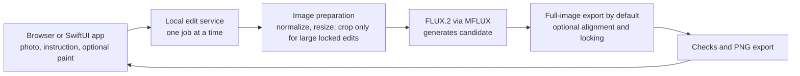

# EditLock engineering architecture

## Product contract

**Input:** an original photo and an edit instruction. The user may paint a focus guide and erase parts of it. They may also explicitly turn on outside locking, in which case the painted area defines where pixels may change.

**Output:** a lossless PNG of the model's full-image edit by default. Painting adds an approximate location cue to the instruction without constraining the output. When outside locking is enabled, every pixel outside the painted area must match the imported photo after decoding and normalization. EditLock saves the instruction, generation settings, and optional paint so the result can be reviewed or retried.

All inference runs on the Mac. FLUX.2 Klein 4B through MFLUX/MLX is the single generator for this version. The completed [baseline](BASELINE.md) shows that the raw model can make useful edits but often changes content elsewhere. Outside locking is available for cases where that matters.

## System map

The app never sends the photo to an online editing service. The model may need to be downloaded during initial setup; later edits use the local model files.

## Components

| Component | Responsibility |
| --- | --- |
| **Browser and SwiftUI app** | Import a photo; enter an instruction; optionally paint and erase a focus guide; optionally lock outside paint; generate or retry; compare before and after; export. |
| **Local edit service** | Keep the model loaded, accept one edit at a time, report progress and errors, and return the result to the app. The app starts and stops this local process. |
| **Image preparation** | Apply photo orientation, normalize colors, keep an immutable original, and resize an inference copy. Large locked edits may use a crop around the painted region. |
| **FLUX.2 adapter** | Send the prepared image and instruction to the existing MFLUX image-editing API. Painted guidance becomes an approximate location phrase in that instruction. FLUX.2 does not receive a hard mask through this API. |
| **Alignment and compositor** | Only in outside-locking mode: align the candidate to the original crop when possible, use candidate pixels where paint allows, and blend the edge inward. Original pixels remain untouched outside it. |
| **Checks and export** | Save the full-image result in instruction-only and guided modes. In locked mode, confirm protected pixels match the original before saving. Record enough information to reproduce or review the edit. |

## One edit from start to finish

1. **Import.** Decode the photo once, apply its orientation, and keep that normalized image unchanged as the source of truth. PNG export preserves the final pixel values; JPEG export would introduce compression changes, so it is outside the first version's exact-pixel guarantee.
2. **Optionally paint focus.** The user can paint where the model should focus and erase part of the guide. This does not restrict output. If they choose outside locking, the paint instead defines the allowed area; for removals and moves it must cover the object, shadows, and any new position.
3. **Prepare the model image.** Use the whole image for instruction-only and guided edits, resizing an inference copy to a model-friendly size. Locked edits on large photos use a crop around paint with context. Keep the full-resolution original.
4. **Generate a candidate.** Send the image and instruction to FLUX.2. Guided edits add a rough location phrase derived from paint. Keep the model loaded for repeated requests. A retry changes the seed and does not overwrite the original.
5. **Place the edit.** Instruction-only and guided modes resize the whole candidate back to the source dimensions. Locked mode aligns when reliable, then combines candidate pixels with the original only inside paint, feathering inward at the boundary.
6. **Check and preview.** In locked mode, compare every pixel outside paint against the normalized original and refuse an export if they differ. In all modes, show before and after so the user can judge whether the instruction worked and retry.
7. **Export.** Save a full-size PNG. In locked mode, pixels outside paint come from the untouched source; in other modes, the model may change the entire image.

## App-to-engine boundary

The first implementation is a Python 3.13 engine callable without a UI. It uses MFLUX/MLX for generation and standard local image libraries for preparation and compositing. The SwiftUI app and localhost browser editor connect through a small FastAPI service bound only to `127.0.0.1`, with a random session token. Each interface sends the source image, instruction, mode, optional paint, and optional retry seed; the service returns the final PNG location, timing, and any error. Only one generation runs at a time to avoid competing GPU jobs. The native app stops its child service to cancel; browser cancellation stops waiting for the request, while the current model edit may finish in the background.

Model files stay in the local ignored cache. Source photos, optional paint, previews, and exports live in a local session folder and are never committed automatically. The app must show a clear error if the model is missing, or if outside locking is enabled without painted pixels.

For the first Mac demo, the app can launch the project's installed Python environment. Packaging a standalone app would require bundling that runtime and arranging the first model download; that is a later distribution task, not a dependency for the first working edit.

## Build order and first deliverable

1. **Instruction-only engine:** accept one photo and one instruction, then save the model's full-image PNG.
2. **Optional focus:** accept paint and erasure, turn the remaining painted region into an approximate location cue, and leave output unconstrained.
3. **Outside locking:** when explicitly chosen, align and blend inside paint, then check exact outside pixels. Use a larger painted area when shadows or new content extend beyond it.
4. **Interfaces and review:** connect the browser and SwiftUI editors, offer retry and comparison, and evaluate instruction success separately from locked preservation.

The **first deliverable** is one real photo plus one instruction producing a saved PNG. Optional painted focus and exact outside locking remain available. Fine-tuning is not part of this build path: the baseline already shows useful editing ability.

## Known limits for the first version

- Outside locking can cut off a new object, shadow, or reflection when paint is too tight. The user can expand it and retry.
- Painted focus is approximate wording added to the model instruction, not spatial control inside FLUX.2. The model may ignore it or change other areas.
- Large edited areas may need downscaling for FLUX.2, so their new content may be softer than the untouched full-resolution photo.
- FLUX.2 sometimes misses a requested edit, particularly size or layout changes in the pilot set. The app should offer retries and show the original; it should not claim every edit succeeds.
- Exact protected pixels do not alone guarantee an attractive boundary. The preview and boundary work are part of the product, not optional polish.
