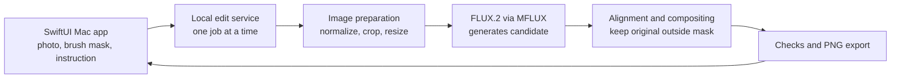

# EditLock engineering architecture

## Product contract

**Input:** an original photo, an edit instruction, and a painted mask showing where change is allowed. The mask may contain more than one painted area, such as both the old and new positions when moving an object.

**Output:** a lossless PNG in which the requested edit appears inside the allowed area. Every pixel outside the mask must match the imported photo after it has been decoded and normalized for editing. EditLock also saves the mask, instruction, and generation settings so the result can be reviewed or retried.

All inference runs on the Mac. FLUX.2 Klein 4B through MFLUX/MLX is the single generator for the first version. The completed [baseline](BASELINE.md) shows why EditLock needs its own region protection: the model can make edits, but its raw output changes content outside the marked area.

## System map

The app never sends the photo to an online editing service. The model may need to be downloaded during initial setup; later edits use the local model files.

## Components

| Component | Responsibility |
| --- | --- |
| **SwiftUI Mac app** | Import a photo; paint, erase, and inspect the editable mask; enter an instruction; generate or retry; compare before and after; export. |
| **Local edit service** | Keep the model loaded, accept one edit at a time, report progress and errors, and return the result to the app. The app starts and stops this local process. |
| **Image preparation** | Apply photo orientation, normalize colors, keep an immutable original, put the mask in original-image coordinates, and prepare a crop around the editable region. |
| **FLUX.2 adapter** | Send the prepared image and instruction to the existing MFLUX image-editing API. It returns a candidate image. FLUX.2 does not receive a hard mask through this API. |
| **Alignment and compositor** | Align the candidate to the original crop when possible, use candidate pixels only where the mask allows, and blend the edge inward from the mask boundary. Original pixels remain untouched outside it. |
| **Checks and export** | Confirm the protected pixels match the original, save a PNG, and record enough information to reproduce or review the edit. |

## One edit from start to finish

1. **Import.** Decode the photo once, apply its orientation, and keep that normalized image unchanged as the source of truth. PNG export preserves the final pixel values; JPEG export would introduce compression changes, so it is outside the first version's exact-pixel guarantee.
2. **Choose the editable area.** The user paints where the change may appear. For a removal, the mask includes the object and its shadow. For a move, it includes both the old and new locations. The app shows the area before generating.
3. **Prepare a local crop.** Find the smallest area covering the mask and add surrounding context so FLUX.2 can understand the scene. If the mask covers most of the image, use the whole image. Resize only the inference copy to a model-friendly size; retain the full-resolution original and the mapping back to its coordinates.
4. **Generate a candidate.** Send the crop and the user's instruction to FLUX.2. Keep the model loaded for repeated requests. A retry changes the seed and produces another candidate; it does not overwrite the original.
5. **Place the edit.** Map the candidate back onto the original. If the candidate has shifted the scene, use unchanged context to align it; reject an unreliable alignment instead of silently moving protected content. Combine the candidate with the original only inside the painted mask. The narrow edge transition happens inside the mask so pixels outside it remain exact.
6. **Check and preview.** Automatically compare protected pixels with the original. If they differ, do not offer the image for export. Show the user a before-and-after view and the mask so they can spot seams, enlarge the editable area, or retry.
7. **Export.** Save a full-size PNG. The area outside the mask comes from the untouched source image, so it keeps the source resolution even when FLUX.2 worked on a smaller crop.

## App-to-engine boundary

The first implementation is a Python 3.13 engine callable without a UI. It uses MFLUX/MLX for generation and standard local image libraries for preparation and compositing. The SwiftUI app then connects through a small FastAPI service bound only to `127.0.0.1`, with a random token shared between the app and its child service. The app sends the source image, mask, instruction, and optional retry seed; the service returns the preview location, final PNG location, timing, and any error. Only one generation runs at a time to avoid competing GPU jobs. Cancelling a generation stops that job; if the model worker must restart, the app reports that it is loading again.

Model files stay in the local ignored cache. Source photos, masks, previews, and exports live in a local session folder and are never committed automatically. The app must show a clear error if the model is missing or the mask is empty.

For the first Mac demo, the app can launch the project's installed Python environment. Packaging a standalone app would require bundling that runtime and arranging the first model download; that is a later distribution task, not a dependency for the first working edit.

## Build order and first deliverable

1. **Region-locking engine:** a command-line path that accepts one photo, one mask, and one instruction and saves a protected PNG. Start with the same FLUX.2 setup already used in the baseline.
2. **Boundary handling:** add crop alignment and inward-only edge blending where the simple composite looks cut out. If an edit needs a shadow or reflection outside the mask, ask for a larger mask instead of changing protected pixels.
3. **Native Mac interface:** add the painting canvas, instruction entry, progress, retry, before-and-after comparison, and export. Connect it to the local engine.
4. **One comparison pass:** run the completed pipeline on the existing 24 examples. Verify exact protected-pixel preservation and review whether the requested edits and boundaries still look convincing. Record the result beside the baseline.

The **first deliverable** is one real photo plus one painted mask plus one instruction producing a saved PNG with the requested change and exact protected pixels. The app follows once this engine works. Fine-tuning is not part of this build path: it would not create the hard region guarantee, and the baseline already shows useful editing ability.

## Known limits for the first version

- A mask that is too tight can cut off a new object, shadow, or reflection. The user must be able to expand it and retry.
- Large edited areas may need downscaling for FLUX.2, so their new content may be softer than the untouched full-resolution photo.
- FLUX.2 sometimes misses a requested edit, particularly size or layout changes in the pilot set. The app should offer retries and show the original; it should not claim every edit succeeds.
- Exact protected pixels do not alone guarantee an attractive boundary. The preview and boundary work are part of the product, not optional polish.
